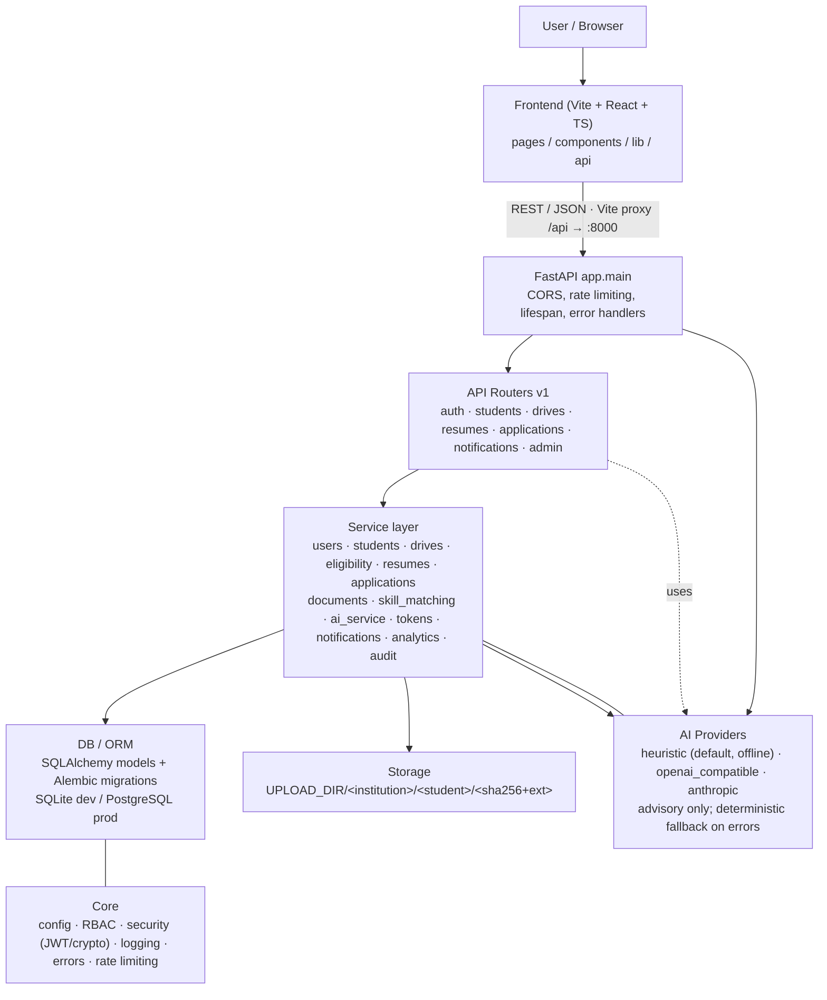
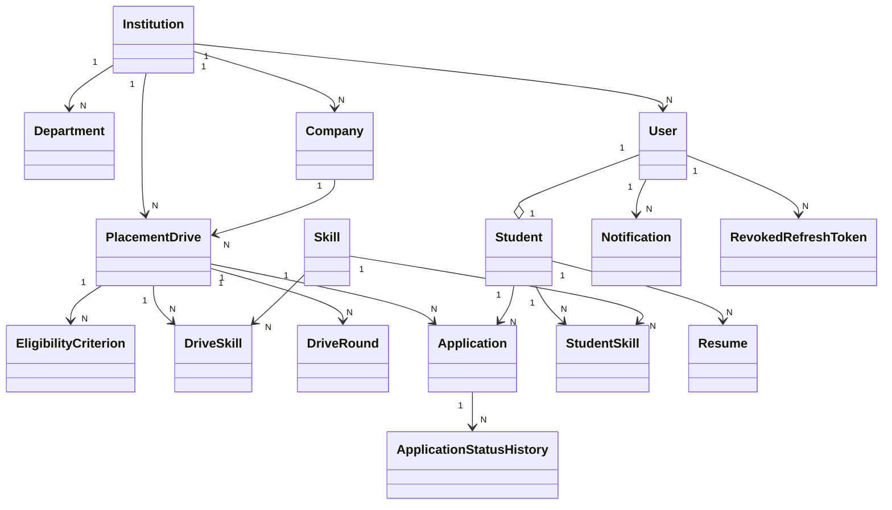
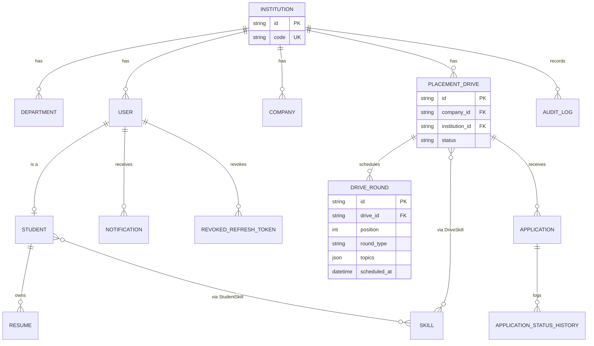
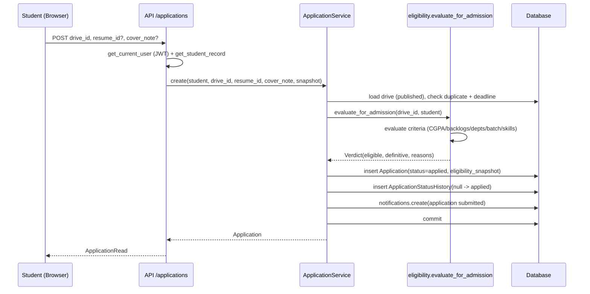
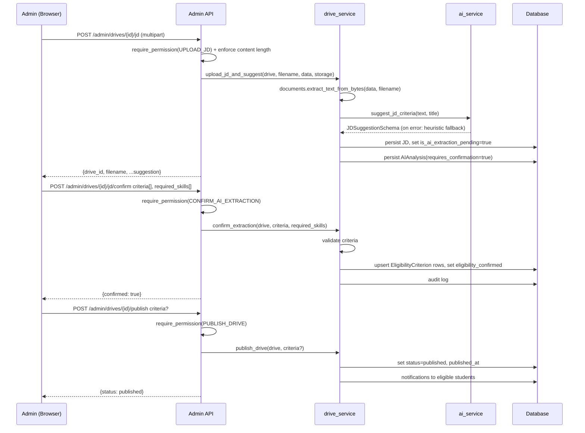
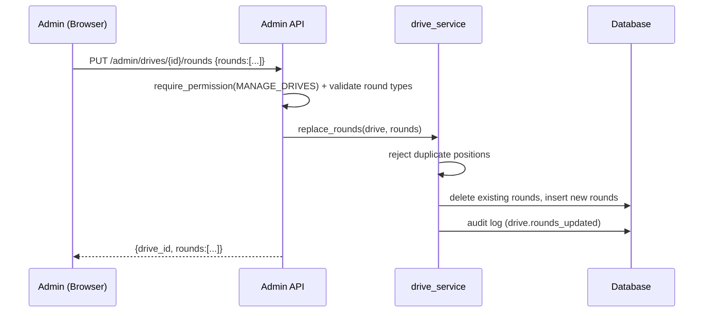
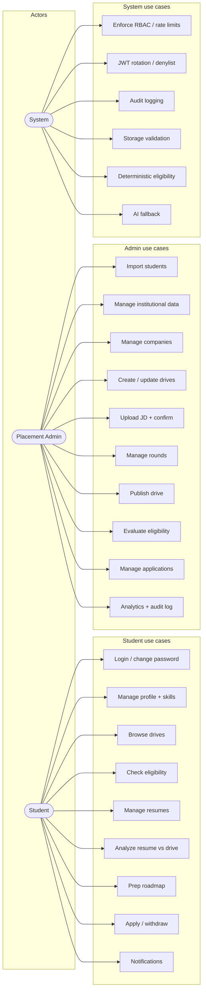

# Architecture

## Block Diagram (High-level)

## Key Components

- **Multi-tenancy**: Every scoped model has `institution_id` (FK to institutions). All queries filter by institution context from auth (`CurrentUser.institution_id`).
- **AuthN/Z**: JWT access/refresh with rotation + server-side denylist (JTI). httpOnly refresh cookie (SameSite=Strict), CSRF header for cookie-based refresh. RBAC via `Permission` enum per route.
- **Deterministic-first**: Eligibility evaluation is pure code. AI calls are advisory; all AI failures degrade to deterministic fallbacks.
- **Append-only history**: Application status history and audit log are never updated/deleted.
- **Tenant-scoped storage**: Resume/JD files stored under an institution/student hierarchy with content-addressed names (sha256 prefix) and extension whitelists.
- **Interview rounds**: A drive owns an ordered list of `DriveRound` rows (online assessment, technical/HR interviews, group discussion, other), editable by admins and read by students; prep-roadmap focus skills are derived from round topics.

## Class Diagram (Models, high-level)

`AIAnalysis` links optionally to student/drive/resume/application. `AuditLog` references an optional institution/actor.

## ER Diagram (Core Entities)

## Sequence Diagram 1: Student applies to a drive

Notes: eligibility is re-evaluated server-side at creation (client cannot self-declare). Snapshot stored at apply time.

## Sequence Diagram 2: Admin uploads JD -> confirms criteria -> publishes

Notes: AI suggestions require explicit confirmation before publication (eligibility_confirmed is only set on confirm). Deterministic fallback applies if the AI provider is unavailable.

## Sequence Diagram 3: Admin maintains drive rounds

Students read the same list (ordered by `position`) via `GET /drives/{id}/rounds`, and the list feeds per-round `focus_skills` in the preparation roadmap.

## Use-Case Diagram (core actors)

